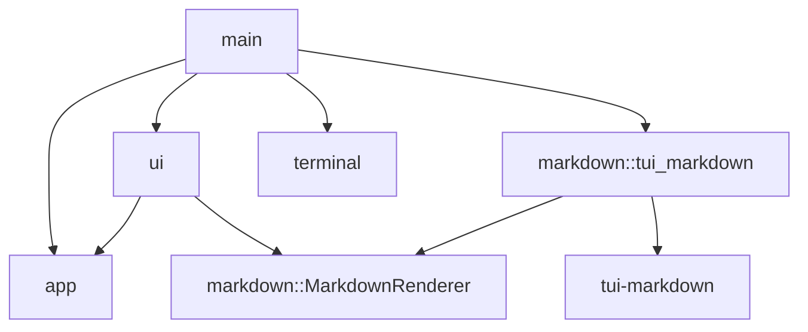
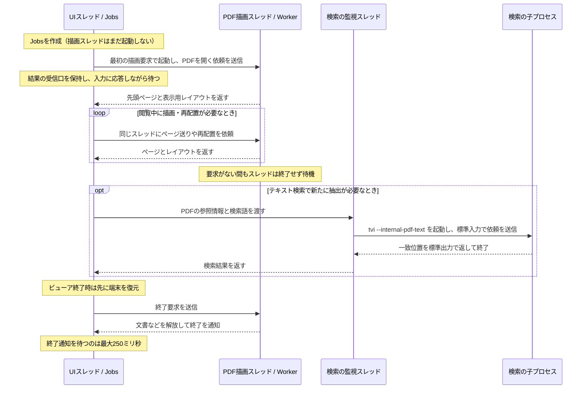

# モジュール構成と依存関係

[目次に戻る](../index.md)

## 対象と前提

[機能仕様](../index.md)のMarkdown・PDF閲覧、3つの動作モード、移動・検索を実現するための構成です。
UIにはratatui、端末制御にはcrossterm、Markdown描画にはtui-markdownを使用します。

## 構成と責務

| モジュール | 責務 |
|---|---|
| `main` | 起動時の文書読み込みと端末初期化を手配し、`session`を開始 |
| `app` | モード、閲覧位置、検索状態、終了要求などの状態と状態遷移 |
| `app::document` | 文書ID・名前・パスと、MarkdownまたはPDFの内容を保持。ファイルI/Oは行わない |
| `app::search` | 文字列検索、一致位置の管理、次／前の一致の選択 |
| `app::command` | コマンド文字列を解釈し、アプリの操作へ変換 |
| `ui` | 本文、ステータス欄、入力欄、ヘルプの描画 |
| `ui::input` | モードに応じたキー入力をアプリの操作へ変換。連続入力も扱う |
| `ui::layout` | 折り返し、画像の占有行、文書内位置と画面位置の対応 |
| `ui::images` | ratatui-imageによる画像セルの描画と本文領域への切り詰め |
| `images` | ローカル画像の読み込み、生成PNGと共通のサイズ・文書予算の検証 |
| `session` | 本文の表示を準備し、現在の文書のデコード済み画像を管理。イベントループで入力や再読み込みを処理 |
| `session::watch` | Markdownのファイル変更通知、再読み込みの予約と失敗時の再試行 |
| `session::pdf` | PDFを開く操作・ページ送り・検索・ズームの非同期要求を管理し、現在の表示に対応する結果だけを反映 |
| `pdf` | Windows.Data.Pdfで要求された1ページをメモリ上のPNGに描画し、別経路で検索用のテキストを抽出 |
| `mermaid` | 変換プロセスの監視、PNGキャッシュ。本文の描画や通知には依存しない |
| `markdown` | Markdown描画のインターフェースを定義 |
| `markdown::tui_markdown` | tui-markdownを呼び出すadapter |
| `terminal` | raw mode、代替画面、イベント取得、画像方式の判定、終了時の端末復元 |

`Mode`や`Action`は、最初から個別ファイルへ分割せず、`app`内に置きます。

## 依存関係

以下の矢印は「依存元 → 依存先」であり、処理順序ではありません。

- `app`は`ui`、`terminal`に依存せず、文書にはadapterのライブラリ非依存な参照情報を保持します。
- `app`はratatui、crossterm、tui-markdownの型を扱いません。
- `ui`はMarkdownの具象adapterを直接生成・参照しません。
- `main`が具象adapterを生成し、`ui`へ渡します。
- ratatuiへの依存は描画系と端末管理に、crosstermへの依存は端末管理とキー入力の解釈に限定します。

## Markdown adapter

Markdownライブラリに依存しないように`MarkdownRenderer`をインターフェースとします。

| 項目 | 内容 |
|---|---|
| 入力 | Markdown文字列、表示幅、抽出済みの参照情報 |
| 出力 | 所有権を持つ`ratatui::Text`、表示幅に依存しない検索用テキスト、元ファイル・描画・検索の位置の対応情報、画像を配置する論理行 |

tui-markdownのAPIを直接使うのは`markdown::tui_markdown`だけです。

[Mermaid表示](mermaid.md)では、adapterが変換結果を受け取り、図に変換し表示します。

## PDF adapter

[PDF表示](../features/pdf.md)はWindows専用です。`windows` crateから Windows.Data.Pdf を呼び、現在要求された1ページだけをPNGにします。
PDFの読み込み、描画、PNGのデコード、表示幅への調整とKitty用のエンコードは、専用スレッド上で行います。

[PDF検索](../features/search.md#pdfの検索対象)では、`pdf-extract` によるファイル読み込み・展開・抽出・照合を別の子プロセスで行います。
一致位置はページ番号とページ内の相対座標で表します。
回転・切り抜きなどにより描画との対応が取れないページは対象外とし、選択した一致を現在の表示幅で描画できた場合にだけページと検索結果を更新します。
PDFのハイライトは、本文幅と倍率に合わせた画像に描画用ワーカーが合成してからKitty用に分割します。

### PDFワーカーの処理の流れ

PDFを直接開いた場合を例に、描画スレッドの起動から終了までと、検索用の子プロセスとの違いを示します。矢印は処理や結果の受け渡しを表します。

## 自動再読み込みの境界

[自動再読み込み](../features/markdown.md#自動再読み込み)にはnotify-debouncer-miniを使い、現在の文書の親ディレクトリだけを非再帰で監視します。ファイル本体ではなく親を監視するため、一時ファイルから置き換える保存にも追従できます。監視を切り替えると古い通知とは切り離し、登録後に一度読み直して切替前の変更も確認します。

監視側は変更や失敗をイベントループへ伝えるだけで、アプリの状態は変更しません。イベントループが読み込み、再試行の時刻、表示への反映を管理します。内容が変わった場合だけ、文書を開くときと同じ経路で描画データを準備します。Mermaidは既存のキャッシュと同期変換を使います。

## 検索とリサイズの位置管理

[検索](../features/search.md)の対象を画面レイアウトから分離します。
adapterは同じ文書解釈から描画用と検索用のテキストを生成し、両者の位置の対応を保ちます。
Markdownでは`app::search`が検索用テキストを扱い、画面上の位置への変換とハイライトは`ui`が担当します。

検索位置と閲覧位置は、画面幅に依存しない文書内の位置を基準に保持します。
`ui::layout`が文書内の位置を折り返し後の表示行へ対応付け、
[リサイズ時](../features/navigation.md)には対応を更新して閲覧位置を維持します。
[Luaからの元ファイル行指定](../features/lua.md#元ファイルの行への移動)では、adapterがパーサーのソース範囲を使って元の行を論理位置に対応付け、`ui::layout` が現在の表示位置を求めます。この対応は検索テキストや表示内容を変更しません。

## 端末の復元

[終了仕様](../features/commands.md)に従い、通常終了と処理可能なエラーでの終了では、
`terminal`がraw modeを解除し、代替画面から復帰します。
端末の初期化に一部成功した後でエラーになった場合も、変更済みの状態を復元します。

## 診断ログの境界

文書読み込み、PDF、画像、Mermaid、Lua、端末の各処理は、失敗した段階と分類済みの理由を共通のログ出力へ渡します。出力側が、[診断ログ仕様](../features/diagnostic-log.md)の形式、記録レベル、サイズ制限、ローテーションを一元管理します。複数プロセス間では書き込みと切り替えが競合しないようにします。ログ出力の失敗は元の処理の成否を変えず、ログに再記録しません。

## 使用ライブラリの参照先

- [ratatui](https://docs.rs/ratatui/latest/ratatui/)
- [crossterm](https://docs.rs/crossterm/latest/crossterm/)
- [tui-markdown](https://docs.rs/tui-markdown/latest/tui_markdown/)
